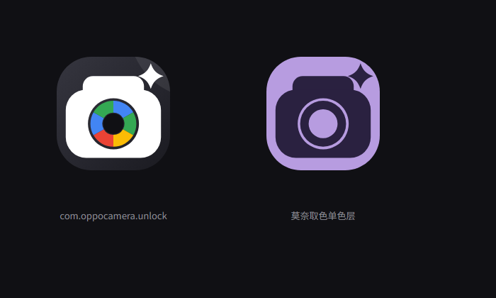

# OPPO 相机解锁（调色盘 / 胶片 / POP / 灵感构图）

[](https://github.com/LucasBlackLu/OPPOCameraUnlock/actions/workflows/build.yml)
[](https://github.com/LucasBlackLu/OPPOCameraUnlock/releases)

把 Reno 17 Pro 的相机色彩能力搬到别的 ColorOS 机器上：**调色盘**、**胶片滤镜**、**实况调色盘 / POP**、
**灵感构图（AI 构图）**。

> 仅在 **OPPO X9（`PLJ110` / ColorOS 17 / Android 17）** 上实测可用。

- 仓库：<https://github.com/LucasBlackLu/OPPOCameraUnlock>
- LSPosed 模块包名：`com.oppocamera.unlock`
- 下载：<https://github.com/LucasBlackLu/OPPOCameraUnlock/releases/latest>



---

## 一、要装两个东西

功能是分两半实现的：**Java 层靠 hook，文件层靠 bind mount**。只装一个不会完整。

| 装什么 | 干什么 | 从哪来 |
|---|---|---|
| **LSPosed 模块** `com.oppocamera.unlock`（本仓库代码） | 部署 LUT、改配置返回值、hook 滤镜门控、接灵感构图取帧桥、提供各类开关 | Release 里的 `com.oppocamera.unlock-*.apk` |
| **Magisk / KernelSU 模块** `oppo_camera_port`（源码在 [`magisk/`](magisk/)） | 换掉只读分区上的文件：相机 APK、`meishe_lut`、retro 配置、`unit.sdk.jar`、`libmsnativefilter.so`、retro UI 资源 | Release 里的 `oppo_camera_port_reno17p.zip` |

### 安装顺序

```sh
# 1) LSPosed 模块
adb install -r com.oppocamera.unlock-*.apk
#    打开 LSPosed → 启用该模块 → 作用域勾上「相机」(com.oplus.camera)
#    （模块已静态声明作用域，一般装完就自动勾好）

# 2) Magisk / KernelSU 模块
adb push oppo_camera_port_reno17p.zip /data/local/tmp/
adb shell su -c "ksud module install /data/local/tmp/oppo_camera_port_reno17p.zip"

# 3) 让文件层生效
adb shell su -c "stop; start"        # 只软重启 framework

# 4) 打开本应用点「重启相机」即可
```

> ⚠️ **不要整机重启**。这两台机器（exploit 注入的 root）整机重启会掉 root。
> 软重启用 `stop; start` 或 Magisk 管理器里的「软重启」。

全部文件投递都是 **bind mount**：`/odm`、`/product` 原文件一个都不改，`uninstall.sh` 里逐个 `umount` 即可回滚。

---

## 二、Reno 17 的调色盘是怎么实现的（重点）

### 2.1 先看清楚它是什么

Reno 17 的调色盘不是一个 UI 控件，而是**一整套 LUT 数据 + 一条三维查表流水线**：

```
/odm/etc/camera/basictone/
├── setting/                     ← 11 张 .ini：哪颗镜头 / 哪个场景用哪套表
│   ├── SimTool.ini
│   ├── SimTool_Palette_Photo_Normal.ini
│   ├── SimTool_Palette_Photo_Night.ini
│   ├── SimTool_Palette_Photo_Portrait.ini
│   ├── SimTool_Preview_Palette_Normal.ini
│   └── …
└── palette/
    ├── HDR/SC16Lut0..8          ← 16³ × 3 × float32 = 49152 B / 张
    └── SDR/SC16Lut0..8
```

- `SC16Lut`：16×16×16 的三维查找表，三平面（R/G/B 分开存），单张 48 KB。
- 一共 9 档，对应 App 里那 9×9 棋盘的两个轴：**影调（SC16）× 取色（CWCM16）**。
- 交叉索引 `index = 饱和度档 × 3 + 影调档`，**第 4 档是 identity（不变）**，所以 81 格里
  每一格都能落到一张具体的 LUT 上。

### 2.2 本机为什么没有

`/odm/etc/camera/basictone` 这张目录两边都叫一样，但本机**整目录缺 `palette/`**：
71 个同名文件里 67 个 md5 完全一致，唯独 `palette/` 一张都没有。

直接强开 feature（把 `com.oplus.feature.color.palette.support` 改成 true）会在 native 里炸：

```
libCombineLut: std::bad_alloc
```

因为 `CombineLutHelper` 会去打开 `palette/HDR/SC16Lut0`，文件不存在 → 读出来是空 buffer →
后面按 48 KB 算大小就越界了。

### 2.3 我们的做法：把 LUT 搬进 APK，再把路径"骗"过去

三段：

**① 数据进包** —— 把 Reno 17 的 `palette/` 塞进 `app/src/main/assets/basictone/`
（`setting/` 用本机原有的，`palette/` 用 Reno 的；9 张 SDR 里有 8 张和 X10 那版不同）。

**② 首次进相机时铺到相机私有目录** —— 相机进程只信任自己的 `files/`：

```
/data/user/0/com.oplus.camera/files/campalette/basictone/
├── .extract        ← 版本戳（如 reno17p-1.0.0），一致就跳过重铺
├── setting/
├── palette/HDR|SDR/
└── odt/            ← 从 /odm 拷（4 张 12 MB，机器上已有，不塞进 APK）
```

铺完必须校验 `palette/HDR/SC16Lut8` 与 `palette/SDR/SC16Lut8` 都是 49152 字节，
否则**放弃重定向**——半套 LUT 会让相机直接崩。

**③ 把相机的加载路径换掉** —— hook 唯一的入口：

```java
com.oplus.ocs.camera.CombineLutHelper#init(6 参)
    arg[2] = setting 路径
    arg[5] = palette 路径
```

`arg[5]` 里含 `palette` 时，把 `setting / palette / odt` 三个参数换成部署目录；
返回码 `palette init code=0` 就是全部 LUT 读成功了。

### 2.4 取色棋盘（9×9 那格子）为什么曾经全黑

面板上那 81 个色格，颜色来自 `PaletteSeekbarColors.get()` → `PaletteSeekbarColorTable`。
本机这个类**不存在**，一 inflate 就 `NoClassDefFoundError`。

早期做法是给它打桩，返回一个空 Recipe —— 结果就是**格子全黑**。正确做法是让真实现跑：

- 我们把 **Reno 17 的 `com.oplus.camera.unit.sdk.jar`** 也换上去了（见第三节），
  `PaletteSeekbarColorTable` 这类 ipusdk 依赖就齐了；
- 于是 hook 里加一条判断：**依赖类在就什么都不做**，让真实现去算颜色。

> 踩过的坑：判断依赖类时包名是 `com.oplus.ocs.camera.**ipusdk**.processunit.filter.palette.*`，
> 不是 `ipuapi` —— 写错就永远判不到，格子一直黑。

### 2.5 调色盘的模式白名单

`com.oplus.camera.common.utils.CommonUtil.isSupportPalette(String mode)` 原文：

```java
if (!CameraConfig.d("com.oplus.feature.color.palette.support", false, false)) return false;
return "common".equals(mode) || "portrait".equals(mode) || "night".equals(mode);
```

即出厂只有 **照片 / 人像 / 夜景** 有调色盘。模块把这条判断 hook 成恒 true
（开关 `persist.camunlock.palette.allmode`），大师模式也能调出调色盘。

---

## 三、胶片滤镜 / 实况调色盘（POP）

| 层 | 做了什么 |
|---|---|
| 滤镜清单 | `com.oplus.camera.unit.sdk.jar` 的 `classes.dex` 里有一张「滤镜 id → `R.string.camera_filter_*`」表。本机 91 处、无 `hu_po`；Reno 版 93 处、含 `hu_po`(琥珀)/`qing_tou`(清透)。→ 整包换上（含 `oat/arm64/*.odex`、`*.vdex`） |
| 胶片 LUT | `/odm/etc/camera/meishe_lut`，路径**硬编码在 native** `libAlgoInterface.so`，Java 改不了 → 只能整目录 bind（135 个文件） |
| Meishe 引擎 | 新版 Java 会给引擎设 `Custom LUT File Path` / `Custom LUT Factor`，原厂 `libmsnativefilter.so` 没有这两个 paramId（日志刷 `Invalid paramId`，滤镜静默失效）→ 换成 Reno 版（11.27 MB，带这两个参数），报错归零、琥珀真正生效 |
| 滤镜组门控 | `FilterGroupManager` 32 个 `initXxxFilterGroup`，三层门控：静态字段 `sbXxxSupport` → 反射置 true；`isXxx()` → hook 成 true；`getConfigBooleanValue(key)` → 40 个 key 里挑 21 个强制放行。实测每组 3~23 个滤镜 |
| 实况调色盘 / POP | 独立模式 `retro_camera_mode`（资源 `camera_mode_retro_camera` 的中文值就是 **"POP"**）。注册要两处：`camera_unit_config` 13~16 处 + `camera_unit_feature_config.protobuf` 追加 39 字节的 `retro_camera` feature（缺它会在 `RetroCameraPresenter.<init>` NPE 崩） |
| POP 的 UI | `apk_resources/{img,json,mp4}`：retro 胶囊 Lottie 动画 + 引导图，整目录 bind |

**注意**：`camera_unit_config` 不要整份换 Reno 的！Reno 版的人像传感器映射和本机对不上，
**进人像模式会预览冻结**（连续两张截图 md5 相同、无 ANR）。必须用「设备原厂 + retro 补丁」那份。

---

## 四、灵感构图（AI 构图）

相机本机带这套能力，只是 feature 默认关着。模块自己把「入口 → 出图 → 引导」三段都接上：

| 阶段 | 做法 |
|---|---|
| 入口 | `CameraConfig.d` 里名字含 `aicomposition` / `ai_composition` 的 key 一律放行；`FeatureConfigureAdapter` 返回的 String 集合里补 `com.oplus.camera.feature.ai_composition`（只补 Collection，**不碰** `getConflictMap` 的 map —— 它的 key 是 `FeatureKey`，塞 String 会在 `FeatureConflictDecision.f()` 里 `ClassCastException` 闪退） |
| 取帧 | 挂相机预览帧类的帧方法，参数里挑带 GPU 用法位、面积最大的那张，存 ThreadLocal。构图调用自己带进来的 buffer 常是 `RGB_888`/私有格式，转 Bitmap 会全黑，所以优先用取帧类抓到的那张 `RGBA_8888` |
| 出图 | 帧 → Bitmap → 喂给相机的 AIUnit 云单元 `cloud_ai_shot_suggestions`，拿回 `{"data":{"zoom":1.8,"center":[384,563],"reason":"…"}}` |
| 翻译 | `zoom`/`center` 反算裁剪框，拼成相机推荐列表认的 `{"outputNum":1,"crops":[{…srcCrop, compositionDesc}]}` |
| 投递 | `runCompositionStreaming(HardwareBuffer, SdkCompositionStreamCallback)` 返回后，调回调的 `onEvent(1, json)` / `onEvent(2, json)`，并把原方法返回值改成 true |
| 引导 | 相机自带的 native 跟踪器在这台机器上一直判「画面变化较大，已退出本次构图」，所以 `initializeTracker` / `track` 的返回值整个换掉：用陀螺仪角速度积分算偏移，回传 `{cx, cy, 0, 3}` |

AIUnit 的接入靠一份 1.5 KB 的桥接 dex（`assets/aiunit/feiyu_aiunit_bridge.dex`）：

```
com.trae.feiyu.cloud.FeiyuFrameDetector  extends com.oplus.aiunit.core.base.FrameDetector
com.trae.feiyu.cloud.FeiyuConnector      extends com.oplus.aiunit.core.a
```

它只有声明，实现全在相机里（`com.oplus.aiunit.*`），所以必须在相机进程里用相机的
ClassLoader 当 parent 动态加载（`InMemoryDexClassLoader`）。

日志：LSPosed 模块日志里搜 `CamUnlock`（`已送入推荐 …` / `跟踪回传 …`），
桥接内部日志同时落在 `/sdcard/Android/data/com.oplus.camera/files/aicomp.log`。

---

## 五、版本矩阵（混淆名会变，换版本必看）

| | 7.006.121（本机原始） | 7.013.60（当前） | 7.016.29 |
|---|---|---|---|
| 预览取帧类（灵感构图） | `wb.r` / `rb.t`，方法 `f` | `tb.u` / `tb.d`，方法 `h` | `tb.q`，方法 `f` |
| 取帧方法特征 | 11 参、含 2~3 个 `HardwareBuffer` | 同 | 同 |
| 灵感 auth 类 | 混淆名 `pb.b` | 非混淆 `…aicomposition.inspiration.network.core.*` | 同 |
| POP 参数面板 `enterPopProfessionalMode` | 无 | **无** | **有**（classes7.dex） |
| 模式 id↔tag 映射类 `com.oplus.camera.v6` | 有 | 变成 IConsumer，不是映射表 | 有 |

取帧类不写死名字：候选列表 `listOf("tb.u", "tb.q", "tb.d", "wb.r", "rb.t")`，
按「11 个参数 + ≥2 个 `HardwareBuffer`」匹配，方法名叫什么都行。

---

## 六、开关一览

| 开关 | 作用 |
|---|---|
| `setprop persist.camunlock.palette.allmode 1` | 调色盘在所有模式可见（含大师） |
| `setprop persist.camunlock.pop 1` | 把 `retro_camera_mode` 注入模式列表 |
| `setprop persist.camunlock.pop.swap 1` | 兜底：v6 映射里把「大师」换成 POP（7.016 有效） |
| `setprop persist.camunlock.filter.director 1` | 放行导演联名滤镜（姜文 / 贾樟柯） |
| `setprop persist.camunlock.filter.{lively,festival,ceremony} 1` | 鲜活 / 节日 / 庆典（LUT 未随固件提供，默认关） |
| `touch /data/adb/modules/oppo_camera_port/enable_retro` | 挂 retro 配置（实况调色盘 / POP 的配置层） |

---

## 七、实测

- `deployed (extracted=29) -> …/campalette/basictone files=34`，二次启动走 `deployed (cached)`
- `palette init code=0`（LUT 全部读成功）
- 调色盘面板：影调 / 饱和度 / 滤镜强度 / 柔光 + 胶片样式（和光 / Portra 胶片 / 800T / CCD…），拖动实时生效，格子颜色正常
- 大师模式调色盘：hook `isSupportPalette` 后可用
- 人像模式：换回设备基底 `camera_unit_config` 后不再冻结（此前整份换 Reno 配置会冻结预览）
- 琥珀 / 清透在滤镜列表里出现，选中后真实生效（`Invalid paramId` 归零）
- 灵感构图入口出现，云端返回 `zoom=2.2 / center=[422,512]`，相机自动变焦并显示构图说明

日志标签：LSPosed 里搜 `CamUnlock`；模块脚本日志 `logcat | grep palette_port`。

---

## 八、编译 / 发版

```powershell
$env:JAVA_HOME = "$env:USERPROFILE\.jdks\jbr-21.0.11"
.\gradlew.bat :app:assembleDebug
```

Gradle 9.7.1 / AGP 9.4.1 / Kotlin 2.4.20 / compileSdk 37 / minSdk 33。

Magisk 模块的打包脚本在 `magisk/build_module.py`（`payload/` 内容由固件提取，不入库），
把 `meishe_lut/`、`apk_resources/`、`config/`、`framework/`、`lib64/`、`apk/OplusCamera.apk`
放进 `magisk/payload/` 的对应目录后：

```sh
python magisk/build_module.py      # 生成 out/oppo_camera_port_reno17p.zip
```

CI（`.github/workflows/build.yml`）：

| 触发 | 动作 |
|---|---|
| push 到 `main` / PR / 手动 | JDK 21 + `platforms;android-37` + `assembleDebug`，APK 传成 artifact |
| 打 `v*` tag | 在上面基础上把 APK 挂进 GitHub Release |

> CI 坑：`compileSdk 37` 对应的包名是 `platforms;android-37.0` 且只在 canary 频道，
> 所以装 SDK 的命令是 `sdkmanager --channel=3 "platforms;android-37.0" "build-tools;36.0.0"`。

---

## 九、已知问题

- **POP 模式没出现在模式条（未打通）**。已经查实的部分：
  - `retro_camera_mode` 在 `camera_unit_config` 里注册了 16 处，SDK 的
    `JsonParser.parseSupportedMode()` 解析结果里**也有**它（hook 日志可证），
    甚至把它插到 `mode_type_list` 最前，模式条 5 格**纹丝不动**；
  - Reno17p 自己的 5 个 config（`oplus_camera_config`（已解密）、
    `oplus_camera_preview_decision_config.json`、`algo_switch_config`、
    `preview_decision_params.json`、`aps_config`）里 **`retro` 出现 0 次**；
  - 换 7.016.29（Reno17p 原版 APK，含 `enterPopProfessionalMode` 那 10 个方法）
    后模式条仍是大屏「大师 / 视频 / 照片 / 人像」；
  - 用 `com.oplus.camera.v6`（7.016 里的模式 id↔tag 映射表）做 master⇄retro 交换，
    hook 装上了（`hooked=2`）但切模式时该方法不被调用；
  - 探过 `com.oplus.camera.o6` / `ha.q0` / `CameraManager`，没有返回 5 个模式名的方法。

  **2026-11-21 更新：模式条/「更多」的来源已经查清（POP 显示能打通，跑起来还差一层）**

  1. **模式条不是 APK 写死**，是相机自己的数据库
     `/data/user/0/com.oplus.camera/databases/mode_data.db`：

     ```sql
     CREATE TABLE mode_info(mode_name TEXT, mode_id INT, position TEXT, rank INT,
                            support_edit TEXT, support_front TEXT);
     ```

     `position='position_headline'` 按 `rank` 排序就是那 5 格；`position='mode_panel'` 是「更多」面板。

  2. **`mode_id` = `zp.j.e(zp.j.k(模式tag))`**。运行时 dump 出来的对照表：

     | tag | resource id | **DB id** |
     |---|---|---|
     | retroCamera（POP） | 2131821668 | **42** |
     | aiScenery（风光） | 2131821617 | 37 |
     | masterVideo | 2131821667 | 36 |
     | highPixel | 2131821441 | 31 |
     | more | 2131821653 | 23 |
     | portrait | 2131821665 | 22 |
     | commonVideo | 2131821680 | 21 |
     | common | 2131821626 | 20 |
     | night | 2131821662 | 5 |
     | professional | 2131821650 | 4 |

     ⚠️ 直接拿 resource id（2131821668）去填 `mode_id` 会让相机启动就崩
     （`Resources$NotFoundException: String resource ID #0x0`），必须是 `e()` 出来的小整数。

  3. **能显示，但点进去会闪退** —— 所以现在**没有**把 POP 留在模式数据里
     （`mode_data.db` 已回原厂 19 行）。原因见下面「POP 闪退的三道门」。
     造库/换库工具：`_tools/make_pop_bar_db.py`、`_tools/dev/apply_safe_db.sh`。

  4. **native 依赖**：换上了 Reno17p 的 `libBasicTonePhoto.so`（591,552 B）。
     原厂那颗 `palette` 相关符号是 **0 个**，Reno 版有 **6 个** —— POP/调色盘走 BasicTone
     时就是靠它。已进模块 `payload/lib64/`，`post-fs-data.sh` 里绑定。

  **POP 闪退的三道门（2026-11-21 逐层查清，前两道已通）**

  | # | 卡点 | 证据 | 状态 |
  |---|---|---|---|
  | 1 | 模式工厂 `cm.x3.a("retroCamera")` 先查 `CameraConfig.getConfigBooleanValue("com.oplus.feature.retro.camera.support")`，false 就 `return null` | 切模式动画结束后 `CameraUIManager.qh` 里 `BaseMode.Vi()` NPE | **已修**：这个一参方法**不经过**三参 `d(...)`，必须单独 hook；修完 POP 模式类 `em.a2` 能正常 new |
  | 2 | 模式拿到的 cameraId 是 Reno 的 **12**（`za.z0.B()` 就是 `return this.v;`），本机只枚举 0..5 | `CameraManager.E4(12)` → `cm.a4.i(12)` 返回 null → `lm.i.s(PreviewProcessor)` 里 `Objects.requireNonNull` NPE | 加了三处兜底 hook（越界折回 0、E4 取不到回落 0），但见第 3 条 |
  | 3 | retro 模式根本没打开过摄像头 | 整个切换过程 `CameraService::connect` 只有启动时那次 camera ID 0；同一刻 `E4(0)` 也是 null；改 `retro_camera_case.preview`（rear_sat→rear_main）、补 `mode_cameraType_sensor_number` 都不改变那个 12 | **未通**，不在 Java 层 |

  第 3 条的 12 出自 unit.sdk（`JsonParser` / `CameraUnitClient`）按 Reno 的单元模型算出来的产物。
  下一步只有两条路：hook 单元模型的产物（`cm/j5` / `cm/a4` 的构造），
  或者走 native（`libAlgoInterface.so` 三处 NOP + 路径重映射，参考 OmniCam-Muse 的 Reno16 移植）。
  只要「胶片效果」的话，`FilterGroupManager.initRetroCameraFilterGroup()` 能无条件填 9 支 retro 滤镜
  （模块已主动调用），把胶片挂到现有模式即可，不需要 retro 模式本身。

  完整证据链：`CameraUnlock/_tools/dev/POP_CRASH_ROOTCAUSE.md`。
  分析用的自研工具链：`_tools/dexdesc.py`、`_tools/dexkit.py`、`_tools/dexcls.py`、
  `_tools/dumpclass.ps1`（自动挑 dex → 设备 dexdump → 只拉目标类片段）。
- **鲜活 / 节日 / 庆典**：LUT（`vibe/festival/ceremony.rgba.bin`）在两台机器固件里都不存在，
  所以做成开关、默认关，开了只多出条目不会有效果。
- **7.013.60 没有 POP 参数面板**（`enterPopProfessionalMode` 只在 7.016.29 里）。
- **分析 APK 一定要用设备上装的那份**：`/data/app/…/base.apk`（7.016.29，
  md5 `fbb77302d89dc710a2d28095fe5b2fa1`）。仓库 `payload` 里一度放过另一份同名构建，
  dex 全不同（连 `zp/j` 都没有），拿它逆会得出完全错误的结论。

---

## 致谢

- [libxposed API](https://github.com/libxposed/api) —— 模块框架
- PUI 设计系统：作者 **天伞桜**（[GitHub](https://github.com/sakurakingfifth-debug/PUIInstaller) · [酷安](https://www.coolapk.com/u/540690)）—— 界面骨架
